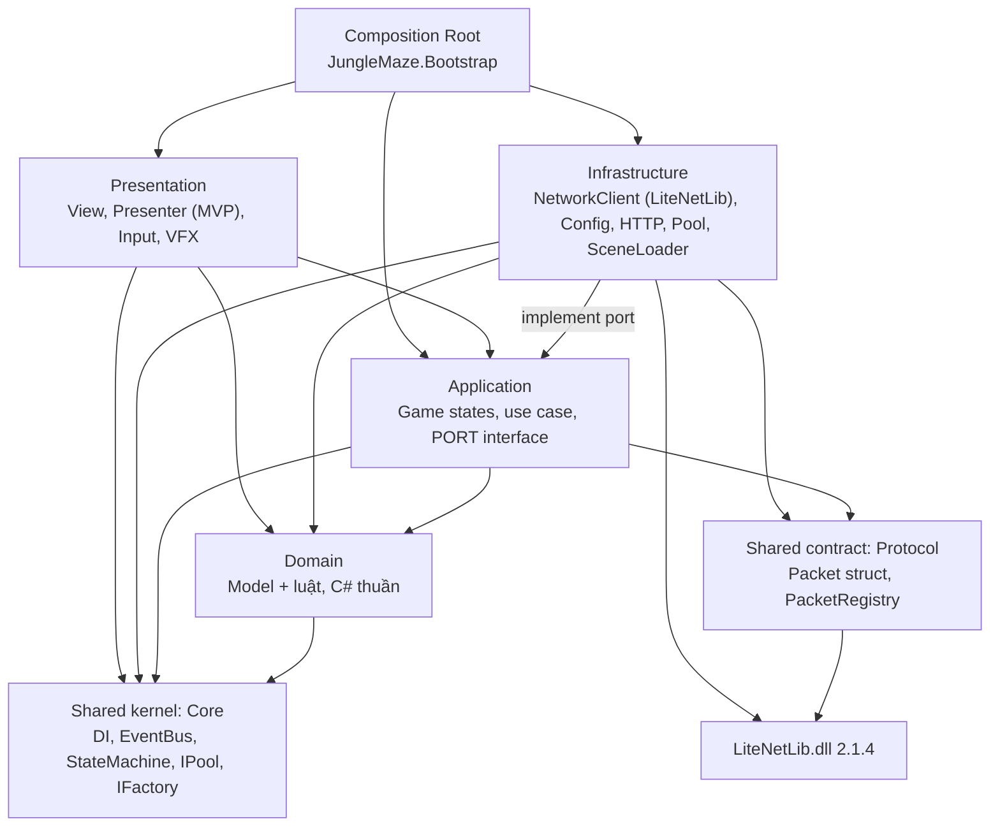
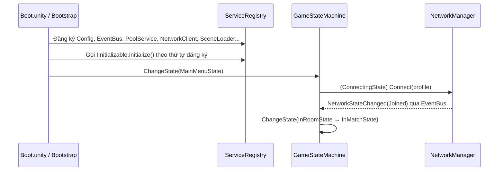
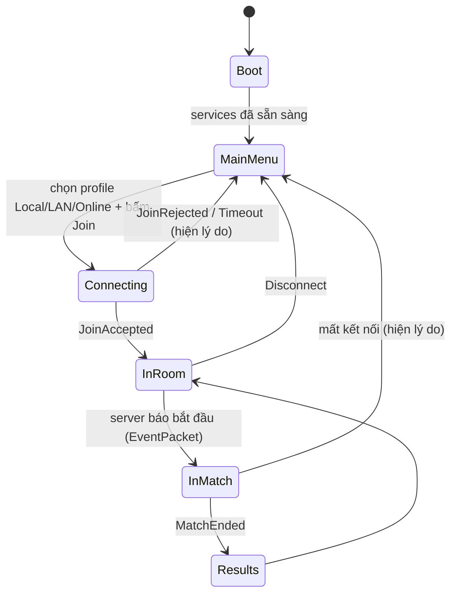
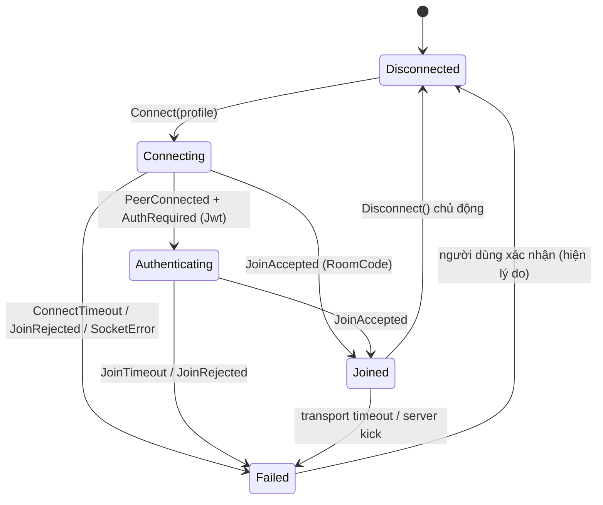

# Kế hoạch triển khai Client Base (CLI-01, CLI-02, CLI-03)

Cập nhật **20/10/2026**. Đối chiếu với [Network_Architecture.vi.md](Network_Architecture.vi.md) (backend/wire protocol) và [JSurviv_Integration.vi.md](JSurviv_Integration.vi.md) (assets tham khảo). Cách dùng hằng ngày nằm ở [Client_Developer_Guide.vi.md](Client_Developer_Guide.vi.md).

## Trạng thái triển khai (20/10/2026)

Bổ sung nghiệm thu **23/10/2026**: CLI-02/CLI-03 có test chạy lại; CLI-04 đã nối config vào công cụ bắn thử; MOV-01 sửa aim và thời điểm áp dụng collider config; ENV-01 có grid, bốn biên và bốn loại Hard Cover chặn Hero/đạn. Chi tiết và giới hạn trong [Unity_Foundation_Acceptance.vi.md](Unity_Foundation_Acceptance.vi.md). Các số 86 test/RTT dưới đây là kết quả lịch sử 20/10, không phải kết quả lượt 23/10.

Bước 1–9 ở mục 7 đã được code, mỗi feature một commit. Có 86 EditMode test xanh. Đã chạy Play Mode với GameServer thật: Joined → InRoom → load scene Game, RTT p95 khoảng 40ms trên loopback; sai mã phòng báo `InvalidRoomCode`. **Chưa** kiểm chứng LAN/VPN thật, 10 máy hay gameplay, vì server chưa xử lý packet gameplay.

Những điểm khác so với bản kế hoạch bên dưới:

| Kế hoạch | Thực tế và lý do |
| --- | --- |
| Package tại `Packages/com.junglemaze.protocol` | Package nằm tại `Backend/Shared/Protocol`, manifest trỏ `file:../Backend/Shared/Protocol`. Dockerfile backend vẫn chỉ copy `Shared/` như cũ |
| Phân biệt packet gameplay bằng channel 1 | LiteNetLib không gửi số channel cho packet Unreliable (luôn tới channel 0), nên frame gameplay có byte đánh dấu `0x80` đứng đầu. Channel 1 chỉ dùng cho gameplay Reliable/Sequenced |
| `IPoolService` ở Core, `PooledPrefabFactory` ở Infrastructure | Core là `noEngineReferences` nên `IPoolService` (dùng kiểu Unity) được đặt ở Application/Ports. `PooledPrefabFactory` cũng ở Application để Presentation dùng được. Core chỉ còn `ObjectPool<T>` thuần C# |
| `SceneContext` trong mỗi scene | Bootstrap tự inject mọi MonoBehaviour có `[Inject]` khi scene load, không cần thêm component |
| `PrefabCatalog` ScriptableObject | Chưa cần: prefab được gán trực tiếp trên component dùng nó (ví dụ `RemotePlayerSpawner`) |
| Namespace `JungleMaze.Application`, thư mục `Presentation/Input` | Đổi thành `JungleMaze.App` và `Presentation/Controls`, để không che `UnityEngine.Application`/`UnityEngine.Input` |
| View uGUI | View viết bằng IMGUI (`ConnectionMenuView`). Presenter không phụ thuộc Unity nên thay view sau không phải sửa logic |
| Config chỉ UDP v1 | Hỗ trợ cả protocol v1 và v2 (attempt ID) vì server đã lên v2. `transport` khác `Udp` bị từ chối rõ ràng |

## 0. Phạm vi ba task

| ID | Nội dung | Ưu tiên | Phụ thuộc | Tiêu chí nghiệm thu (rút gọn) |
| --- | --- | --- | --- | --- |
| CLI-01 | NetworkManager Unity (LiteNetLib): connect/disconnect, packet/event trong Update, nạp `apiBaseUrl`, `gameServerHost`, `gameServerPort` từ config ngoài build; chọn Local/LAN/Online | P0 | SRV-01 | Cùng build nối được localhost, IP LAN, IP VPN, trao đổi ping/pong. Đổi endpoint không build lại. Trạng thái/timeout rõ ràng. Ghi RTT thực tế |
| CLI-02 | Serializer packet nhị phân dùng chung: `PlayerInputPacket`, `PlayerStatePacket`, `EventPacket`, dùng `NetPacketProcessor` | P0 | CLI-01 | Serialize/deserialize **0 byte GC alloc**. NetworkManager/transport chỉ gọi serializer, không tự encode |
| CLI-03 | Nền tảng game & design pattern: Object Pool, Factory, State Pattern, Observer, Constructor/Method Injection, một Bootstrap | P1 | — | Người làm gameplay dùng được mà không phải sửa Core |

**Ranh giới:** CLI-01 lo transport/endpoint/kết nối. CLI-02 chỉ lo schema và encode/decode, không sở hữu transport hay việc gửi/nhận. CLI-03 không chứa gameplay cụ thể (không có Player, Weapon...), chỉ chứa công cụ để gameplay dùng.

## 1. Pattern kiến trúc: Layered Architecture theo Clean Architecture

Client Unity dùng **Layered Architecture** (kiến trúc phân lớp), áp dụng **quy tắc phụ thuộc của Clean Architecture**: các lớp ngoài phụ thuộc vào lớp trong, lớp trong không biết lớp ngoài. Lớp hạ tầng (mạng, file, Unity API) **implement interface do lớp Application khai báo**, tức là dùng Dependency Inversion. Nhờ vậy có thể thay LiteNetLib, thay nguồn config hoặc viết bản giả để test mà không phải sửa logic game.

### 1.1. Vì sao chọn pattern này

| Pattern | Kết luận | Lý do |
| --- | --- | --- |
| **Layered + Clean (chọn)** | Dùng cho toàn bộ client | Ánh xạ thẳng sang asmdef nên compiler tự chặn phụ thuộc sai. Dễ dạy, dễ review ("code này thuộc lớp nào?"). Cùng tư duy với Backend API (Controller → Service → Repository) mà team đã quen |
| Microservice | Không dùng cho client | Microservice là kiến trúc **hệ thống phân tán**: nhiều process độc lập giao tiếp qua mạng. Client Unity chỉ là một process. Ở cấp hệ thống, dự án đã tách dịch vụ: API, GameServer, MongoDB, Caddy |
| MVC / MVP | Dùng **bên trong** Presentation | Chỉ giải quyết tách UI khỏi logic. Không đủ để tổ chức network, config, DI |
| ECS / DOTS | Không dùng ở phase này | Hiệu năng cao nhưng khó học, không khớp code MonoBehaviour của JSurviv. Quy mô 10 người chơi không cần |
| Feature folders (vertical slice) | Dùng để chia thư mục **bên trong** mỗi lớp | Mỗi tính năng (Player, Combat, Inventory) có thư mục riêng trong từng lớp, nên dễ tìm file khi làm một tính năng |

Vị trí trong toàn hệ thống:

| Cấp | Pattern |
| --- | --- |
| Hệ thống | Client–Server, server authoritative; các dịch vụ backend tách riêng (API, GameServer, DB, reverse proxy) |
| Backend API | Layered: Controller → Service → Repository, có DI |
| GameServer | Composition root + fixed tick loop (đã có), sẽ thêm lớp simulation |
| **Unity client** | **Layered + Clean** (tài liệu này), MVP trong Presentation |

### 1.2. Nguyên tắc bắt buộc

1. **Quy tắc phụ thuộc.** Chỉ được tham chiếu lớp trong hơn. Không có tham chiếu ngược hay vòng. asmdef đảm bảo việc này lúc compile.
2. **Một composition root.** Mọi object được tạo và nối trong `Bootstrap`. Không `FindObjectOfType`, không singleton tĩnh kiểu `X.Instance` trong code mới.
3. **Main thread là duy nhất.** LiteNetLib `UnsyncedEvents = false`; `PollEvents()` chạy trong `Update`, nên mọi event mạng tới gameplay đều ở main thread.
4. **Hot path không cấp phát.** Packet là `struct`; writer/reader/processor tái sử dụng; không string/LINQ/boxing trong packet tick.
5. **Server authoritative.** Client gửi input và hiển thị state; không tự quyết HP/damage/vị trí cuối cùng.
6. **Không đụng mã JSurviv.** Code mới nằm ở thư mục và assembly riêng. Tái dùng JSurviv qua adapter ở Presentation/Infrastructure (đúng khuyến nghị trong JSurviv_Integration). Không tham chiếu assembly `SurvivTCP` từ Domain/Application/Core.

## 2. Kiến trúc chi tiết

### 2.1. Các lớp, assembly và hướng phụ thuộc

| Lớp | Assembly | Chứa gì | Được tham chiếu | Cấm |
| --- | --- | --- | --- | --- |
| **Presentation** | `JungleMaze.Presentation` | MonoBehaviour View, UI theo MVP (View + Presenter), đọc Input System, Animator, VFX, camera, `NetworkStatsOverlay` | Application, Domain, Core | LiteNetLib, đọc file, HTTP |
| **Application** | `JungleMaze.Application` | Game states (State Pattern), use case/service điều phối (`ConnectToServer`, `SendPlayerInput`, `WorldSyncService`), **port interface**: `INetworkClient`, `IPacketSender`, `IConfigProvider`, `ISceneLoader`, `IAuthApi` | Domain, Core, Protocol | MonoBehaviour cụ thể, LiteNetLib transport |
| **Domain** | `JungleMaze.Domain` (`noEngineReferences`) | C# thuần: model và luật phía client (`PlayerModel`, `MatchModel`, `NetworkState`, `DisconnectReason`, domain event) | Core | Unity API, Protocol, mọi lớp ngoài |
| **Infrastructure** | `JungleMaze.Infrastructure` | Implement các port: `NetworkClient` (LiteNetLib) + vỏ `NetworkManager`, `ClientConfigLoader` (file/command line), `AuthApiClient` (UnityWebRequest), `SceneLoader`, `PoolService` (UnityEngine.Pool), `TickRunner` | Application, Domain, Core, Protocol, LiteNetLib | Presentation |
| **Shared kernel** | `JungleMaze.Core` (`noEngineReferences`) | Công cụ dùng chung: DI (`ServiceRegistry`), `EventBus`, `StateMachine`, interface `IFactory`/`IPoolService`/`IPoolable`/`ITickable`, `ILog` | Không gì | Mọi lớp khác |
| **Shared contract** | `JungleMaze.Protocol` (local package, dùng chung với Backend) | Packet struct, opcode, version, `PacketRegistry` | LiteNetLib | Unity API |
| **Composition root** | `JungleMaze.Bootstrap` | `Bootstrap`, `SceneContext`: tạo và nối mọi thứ | Tất cả | Chứa logic game |



- Presentation và Infrastructure là **hai lớp ngoài ngang hàng**, không biết nhau. Chúng chỉ gặp nhau qua interface ở Application.
- Domain và Core không tham chiếu `UnityEngine`, nên test EditMode chạy nhanh, không cần scene.
- Test: `JungleMaze.Tests.EditMode` tham chiếu Domain/Application/Core/Protocol (dùng fake cho port); `JungleMaze.Tests.PlayMode` tham chiếu Infrastructure để test với server local.

**Luồng dữ liệu mẫu (gửi input và nhận state):**

```text
Gửi:   Presentation.PlayerInputReader (Input System)
         → Application.PlayerInputService (gom input 30Hz, điền PlayerInputPacket)
         → IPacketSender (port ở Application)
         → Infrastructure.NetworkClient → PacketRegistry → LiteNetLib
Nhận:  LiteNetLib → Infrastructure.NetworkClient → PacketRegistry handler
         → Application.WorldSyncService cập nhật Domain.PlayerModel
         → EventBus.Publish(PlayerStateUpdated)
         → Presentation.PlayerView nội suy vị trí và render
```

**Design pattern của CLI-03 nằm ở lớp nào:**

| Pattern | Interface / class gốc | Implement / nơi dùng |
| --- | --- | --- |
| Dependency Injection | `ServiceRegistry` (Core) | Nối trong Composition Root; constructor injection cho service, method injection `Construct(...)` cho MonoBehaviour |
| Observer | `IEventBus`, `EventBus` (Core) | Mọi lớp publish/subscribe; event định nghĩa ở Domain/Application |
| State | `IState`, `StateMachine` (Core) | Game states ở Application; AI/nhân vật ở Domain hoặc Presentation |
| Object Pool | `IPoolService`, `IPoolable` (Core) | `PoolService` ở Infrastructure; `IPoolable` trên View ở Presentation |
| Factory | `IFactory<TArgs, T>` (Core) | `PooledPrefabFactory` ở Infrastructure; factory theo tính năng do team gameplay viết |
| MVP | — | Presentation (View chỉ hiển thị, Presenter nghe Application/EventBus) |
| Bootstrap | — | Composition Root |

### 2.2. Cấu trúc thư mục đề xuất

Mỗi lớp là một thư mục có asmdef riêng. Bên trong mỗi lớp chia theo tính năng.

```text
Assets/_JungleMaze/
  Scenes/
    Boot.unity                   # scene index 0, chỉ có Bootstrap
    MainMenu.unity
    Game.unity
  Scripts/
    Core/                        # JungleMaze.Core.asmdef (noEngineReferences)
      DI/            ServiceRegistry.cs, IInitializable.cs, IInjectable.cs
      Events/        IEvent.cs, IEventBus.cs, EventBus.cs
      StateMachine/  IState.cs, StateMachine.cs
      Pooling/       IPoolable.cs, IPoolService.cs
      Factory/       IFactory.cs
      Time/          ITickable.cs
      Logging/       ILog.cs
    Domain/                      # JungleMaze.Domain.asmdef (noEngineReferences)
      Network/       NetworkState.cs, DisconnectReason.cs, NetworkStateChanged.cs
      Player/        PlayerModel.cs            # team gameplay mở rộng
      Match/         MatchModel.cs
    Application/                 # JungleMaze.Application.asmdef
      Ports/         INetworkClient.cs, IPacketSender.cs, IConfigProvider.cs, ISceneLoader.cs, IAuthApi.cs
      States/        BootState.cs, MainMenuState.cs, ConnectingState.cs, InRoomState.cs, InMatchState.cs
      Network/       ConnectToServerUseCase.cs, WorldSyncService.cs
      Player/        PlayerInputService.cs
    Infrastructure/              # JungleMaze.Infrastructure.asmdef
      Network/       NetworkClient.cs, NetworkManager.cs, RttTracker.cs
      Config/        ClientConfig.cs, ClientConfigLoader.cs
      Auth/          AuthApiClient.cs
      Pooling/       PoolService.cs, PooledObject.cs, PooledPrefabFactory.cs
      Scenes/        SceneLoader.cs
      Time/          TickRunner.cs            # một Update duy nhất gọi mọi ITickable
    Presentation/                # JungleMaze.Presentation.asmdef
      UI/MainMenu/   MainMenuView.cs, MainMenuPresenter.cs
      UI/Debug/      NetworkStatsOverlay.cs
      Input/         PlayerInputReader.cs
      Player/        PlayerView.cs            # team gameplay mở rộng
    Bootstrap/                   # JungleMaze.Bootstrap.asmdef
      Bootstrap.cs, SceneContext.cs, PrefabCatalog.cs
  Tests/
    EditMode/  ProtocolTests.cs, ZeroAllocTests.cs, StateMachineTests.cs, EventBusTests.cs, ConfigTests.cs
    PlayMode/  NetworkClientLocalTests.cs, PoolServiceTests.cs
  Settings/
    ClientSettings.asset         # ScriptableObject: timeout, tick rate, pool warmup...
Assets/StreamingAssets/
  client.local.json              # cấu hình mặc định đi theo build
Packages/com.junglemaze.protocol/  # Shared contract dùng chung với Backend (xem 4.1)
Assets/Plugins/LiteNetLib/LiteNetLib.dll
```

### 2.3. Luồng khởi động



- `Bootstrap` là MonoBehaviour duy nhất có `DontDestroyOnLoad`, nằm trong `Boot.unity` (đặt index 0 trong Build Settings, trước `SampleScene`).
- Khi dev bấm Play ở scene bất kỳ (ví dụ `Game.unity`): một hàm `[RuntimeInitializeOnLoadMethod(BeforeSceneLoad)]` kiểm tra nếu chưa có Bootstrap thì tạo từ prefab. Dev test scene lẻ không phải mở Boot trước.

## 3. CLI-03 — Nền tảng & design pattern

Làm **trước một lát mỏng** (DI + EventBus + StateMachine + Bootstrap) vì CLI-01 cần chỗ để đăng ký service và phát event. Pool/Factory hoàn thiện sau.

### 3.1. Dependency Injection (Constructor + Method Injection)

Tự viết một `ServiceRegistry` nhỏ, không dùng thư viện ngoài (giữ project đơn giản cho lớp học; nếu sau này cần scope phức tạp mới cân nhắc VContainer).

| Loại đối tượng | Cách inject | Ví dụ |
| --- | --- | --- |
| C# class thuần (service) | **Constructor injection**, tạo trong Bootstrap | `new NetworkClient(config, eventBus, packetRegistry)` |
| MonoBehaviour (Unity tự tạo, không có constructor) | **Method injection**: `public void Construct(IEventBus bus, IPoolService pool)` | `PlayerView.Construct(...)` do Factory gọi ngay sau Instantiate/Spawn |
| MonoBehaviour đặt sẵn trong scene | Một `SceneContext` trong mỗi scene, khi scene load sẽ gọi `Construct` cho các component implement `IInjectable` | HUD, spawn point |

```csharp
// API tối thiểu dự kiến
public sealed class ServiceRegistry
{
    public void Register<TService>(TService instance) where TService : class;
    public TService Resolve<TService>() where TService : class;   // chỉ dùng trong Bootstrap/Factory/SceneContext
    public bool TryResolve<TService>(out TService service) where TService : class;
}
```

Quy tắc cho team: **gameplay code không gọi `Resolve`**. Chỉ nhận dependency qua constructor hoặc `Construct(...)`. `Resolve` chỉ được gọi trong Bootstrap, Factory và SceneContext, để mọi phụ thuộc đều nhìn thấy được ở chữ ký hàm.

Vòng đời: service implement `IInitializable` (gọi sau khi đăng ký xong), `ITickable` (được `TickRunner` gọi mỗi frame, thay cho việc mỗi service tự có `Update`), `IDisposable` (gọi ngược thứ tự khi thoát game).

### 3.2. Observer — EventBus

- Event là `readonly struct` implement `IEvent` để publish không cấp phát.
- `EventBus` lưu danh sách handler theo kiểu: `Subscribe<T>(Action<in T>)`, `Unsubscribe<T>`, `Publish<T>(in T evt)`. Bản đầu dùng `Action<T>`; nếu đo thấy cần thì đổi sang `in`-delegate.
- Publish an toàn khi handler tự unsubscribe trong lúc đang duyệt (duyệt bản sao hoặc đánh dấu xóa trễ).
- **Khi nào dùng EventBus và khi nào dùng C# `event`:** EventBus cho thông báo liên module (`NetworkStateChanged`, `PlayerSpawned`, `MatchEnded`). C# `event`/callback trực tiếp cho quan hệ cha–con trong cùng module.
- Bắt buộc unsubscribe trong `OnDisable`/`Dispose`. Ở Editor, thêm cảnh báo khi số handler tăng bất thường để phát hiện leak.

### 3.3. State Pattern — vòng đời client/menu

```csharp
public interface IState { void Enter(); void Tick(float dt); void Exit(); }
public sealed class StateMachine { public IState Current { get; } public void ChangeState(IState next); public void Tick(float dt); }
```

State cấp ứng dụng (lớp Application, `Application/States`):



- Mỗi state nhận dependency qua constructor (ví dụ `ConnectingState(INetworkClient, IEventBus, IUiService)`).
- Load scene bằng một `ISceneLoader` (async, dùng UniTask có sẵn trong project). State không tự gọi `SceneManager`.
- Cùng class `StateMachine` được dùng lại cho gameplay (AI, state nhân vật). Team gameplay không phải viết state machine mới.

### 3.4. Object Pool

- Interface `IPoolService`/`IPoolable` nằm ở Core. Bản implement `PoolService` nằm ở Infrastructure và bọc `UnityEngine.Pool.ObjectPool<T>` (có sẵn trong Unity) thay vì tự viết cấu trúc dữ liệu.
- `IPoolable { void OnSpawned(); void OnDespawned(); }`: component reset trạng thái tại đây (đạn reset velocity, VFX restart particle).
- `PoolService`: `Spawn(prefab, pos, rot)`, `Despawn(instance)`, `Prewarm(prefab, count)`, mỗi prefab một pool. Instance biết pool gốc qua component `PooledObject`, nên `Despawn` không phải tra dictionary.
- Hỗ trợ tự despawn sau thời gian (VFX) bằng timer trong `TickRunner`, không dùng coroutine riêng cho mỗi object.
- Editor/Dev build: kiểm tra despawn hai lần và hiện số active/inactive theo pool trong overlay debug.
- Tham khảo `[Codebase]/ObjectPool` của JSurviv để lấy ý tưởng, không copy nguyên vì code cũ dùng singleton.

### 3.5. Factory

- `IFactory<TArgs, TProduct>`: tạo đối tượng **qua pool** và **inject dependency** (gọi `Construct`) ngay sau khi lấy ra, nên object luôn đủ dependency trước khi `OnSpawned` chạy.
- Ví dụ team gameplay sẽ viết: `ProjectileFactory : IFactory<ProjectileSpawnArgs, Projectile>`, `RemotePlayerFactory`. Core chỉ khai báo `IFactory`; Infrastructure cung cấp `PooledPrefabFactory<T>` dùng chung.
- Cấu hình prefab nằm trong ScriptableObject (`PrefabCatalog`), không hard-code đường dẫn `Resources`.

### 3.6. Bootstrap

```csharp
public sealed class Bootstrap : MonoBehaviour
{
    [SerializeField] ClientSettings settings;      // ScriptableObject
    [SerializeField] PrefabCatalog prefabs;
    void Awake()
    {
        DontDestroyOnLoad(gameObject);
        var registry = new ServiceRegistry();
        var config   = ClientConfigLoader.Load(settings);       // CLI-01
        var bus      = new EventBus();
        var packets  = new PacketRegistry();                    // CLI-02
        var net      = new NetworkClient(config, bus, packets); // CLI-01
        // ... Register tất cả, rồi Initialize theo thứ tự, rồi ChangeState(MainMenu)
    }
}
```

Thứ tự khởi tạo được viết tường minh trong một hàm, đọc từ trên xuống là thấy toàn bộ đồ thị phụ thuộc.

## 4. CLI-02 — Serializer packet nhị phân dùng chung

### 4.1. Chia sẻ code giữa Unity và Backend

Hiện `Backend/Shared/NetworkProtocol.cs` được Compile Link vào GameServer/NetSmokeClient. Unity không link được file ngoài `Assets/`/`Packages/`. Đề xuất:

1. Tạo local package `Packages/com.junglemaze.protocol/Runtime/` với asmdef `JungleMaze.Protocol` (`noEngineReferences: true`, tham chiếu `LiteNetLib.dll`).
2. Chuyển `NetworkProtocol.cs` và các packet mới vào đây làm **nguồn duy nhất**. Đổi các csproj backend thành `<Compile Include="../../Packages/com.junglemaze.protocol/Runtime/**/*.cs" />`.
3. Unity 6 biên dịch C# 9, nên code trong package phải **tương thích C# 9**: không file-scoped namespace (file hiện tại đang dùng, cần đổi sang dạng `namespace X { }`); `record` cần shim `IsExternalInit`, hoặc đổi `JoinRequest` thành `readonly struct`. Bật `<LangVersion>9.0</LangVersion>` cho phần shared phía backend để lỗi lộ ra ngay khi build server.
4. LiteNetLib phía Unity dùng **cùng phiên bản 2.1.4** (DLL netstandard2.1 trong `Assets/Plugins/LiteNetLib`).

Cách này giữ một nguồn sự thật cho wire format. Sửa packet ở một chỗ thì cả server lẫn client cùng compile lại, lệch phiên bản lộ ra lúc build chứ không lộ ra lúc chạy.

### 4.2. Kênh và tương thích protocol v1

- **Channel 0 / control:** giữ nguyên handshake v1 (Ping/Pong/Auth/JoinAccepted/JoinRejected/AuthRequired, byte type đầu packet). Không phá SRV-01 và NetSmokeClient.
- **Channel 1 / gameplay:** packet đi qua `NetPacketProcessor`. Cần đặt `ChannelsCount = 2` ở **cả** client và GameServer, và nâng `NetworkProtocol.Version` lên 2 khi bật gameplay packet.
- Delivery: `PlayerInputPacket`: `Unreliable` (hoặc `Sequenced`), gửi 30Hz khớp tick server. `PlayerStatePacket`: `Unreliable`/`Sequenced`. `EventPacket`: `ReliableOrdered`.
- Lưu ý: `NetPacketProcessor` thêm header hash 8 byte cho mỗi packet. Với 10 người × 30Hz chi phí này chấp nhận được. Nếu sau này cần tối ưu băng thông thì thay bằng opcode 1 byte mà không đổi API của serializer.

### 4.3. Schema dự kiến (bản đầu, chốt với người làm server)

Tất cả là `struct` implement `INetSerializable`, chỉ dùng kiểu cố định kích thước.

| Packet | Trường | Ghi chú |
| --- | --- | --- |
| `PlayerInputPacket` | `uint Tick`, `ushort InputSeq`, `sbyte MoveX`, `sbyte MoveY` (lượng tử −127..127), `short AimAngle` (độ ×100 hoặc 0..65535), `byte Buttons` (bitmask: Attack, Interact, Reload, Dash...) | ~11 byte payload. `InputSeq` dùng cho reconcile sau này |
| `PlayerStatePacket` | `uint Tick`, `byte NetId`, `float X`, `float Y`, `short Rotation`, `ushort LastProcessedInputSeq`, `byte Hp`, `byte Flags` (dead, invulnerable...) | Bản đầu một player một packet; sau gom thành snapshot nhiều entity |
| `EventPacket` | `uint Tick`, `byte EventType`, `byte SourceNetId`, `byte TargetNetId`, `int Param1`, `int Param2` | Dạng chung cho MatchStart/Hit/Death/ItemPickup. Event cần dữ liệu riêng thì tách packet riêng |

**Điểm cần quyết với server:** hiện `JoinAccepted` trả `PlayerId` dạng **string**. Packet gameplay không nên mang string (tốn byte và cấp phát). Đề xuất server gán thêm `byte NetId` (chỉ số slot 0..9) và gửi kèm trong `JoinAccepted` của protocol v2.

### 4.4. API serializer

```csharp
public sealed class PacketRegistry           // trong JungleMaze.Protocol, dùng chung server/client
{
    public PacketRegistry();                 // đăng ký sẵn mọi packet struct
    public void Write<T>(NetDataWriter writer, ref T packet) where T : struct, INetSerializable;
    public void Subscribe<T>(PacketHandler<T> handler) where T : struct, INetSerializable;
    public void ReadAllPackets(NetDataReader reader, object userData);
}
```

- Bên trong dùng `NetPacketProcessor.WriteNetSerializable` / `SubscribeNetSerializable` (sẽ kiểm tra lại đúng chữ ký API của LiteNetLib 2.1.4 khi code).
- `NetworkClient` chỉ gọi `registry.Write(...)` rồi `peer.Send(writer, ...)`. Khi nhận channel 1 thì gọi `registry.ReadAllPackets(...)`. Transport không biết trường nào của packet.
- Gameplay gửi qua `IPacketSender.Send(ref packet, DeliveryMethod)`, không chạm writer.

### 4.5. Kiểm chứng 0 GC alloc

- EditMode test: tạo trước `NetDataWriter`/`NetDataReader`/registry, warm-up một lần, rồi lặp 10.000 lần serialize + deserialize mỗi loại packet trong khối `Assert.That(() => {...}, Is.Not.AllocatingGCMemory())` (constraint của Unity Test Framework).
- Test round-trip: giá trị biên (Tick max, Move −127/127, Buttons đủ bit) ghi ra rồi đọc lại phải bằng nhau. Packet thiếu byte hoặc thừa byte phải bị từ chối, giống cách v1 đang kiểm.
- Profiler: ghi lại kết quả GC Alloc = 0 B ở marker `Network.Poll` trong Play Mode để làm bằng chứng nghiệm thu.

## 5. CLI-01 — NetworkManager Unity

### 5.1. Cấu hình ngoài build

Dùng cùng schema với `Backend/NetSmokeClient/client.*.json` để một file chạy được cho cả hai:

```json
{
  "mode": "Local",
  "apiBaseUrl": "http://localhost:5000",
  "gameServerHost": "127.0.0.1",
  "gameServerPort": 7777,
  "authMode": "RoomCode",
  "protocolVersion": 1,
  "connectTimeoutMs": 5000
}
```

Thứ tự tìm file (cái sau ghi đè cái trước):

1. `StreamingAssets/client.local.json`: mặc định đi theo build.
2. `Application.persistentDataPath/client.json`: người test tự sửa, không phải build lại.
3. Tham số dòng lệnh `-clientConfig <path>` hoặc `-host <ip> -port <n>`: tiện mở nhiều client trên một máy.

Menu trong game có dropdown **Local / LAN / Online** và ô nhập host/port. Giá trị người dùng nhập được lưu vào (2). Validate giống `ClientOptions.Load` (host không chứa `http://`, port 1..65535, timeout 500..60000, API từ xa phải HTTPS hoặc IP Tailscale). Chuyển phần validate thành code dùng chung trong package protocol nếu được.

### 5.2. Máy trạng thái kết nối



- `NetworkState` và `DisconnectReason` là enum. Reason map đúng danh sách server (`RoomFull`, `InvalidRoomCode`, `AuthTimeout`, `DuplicateSession`...) cộng thêm `ConnectTimeout`, `JoinTimeout`, `SocketError`, `UserRequested`.
- Mỗi lần đổi trạng thái publish `NetworkStateChanged { Previous, Current, Reason }` lên EventBus. UI và State chỉ lắng nghe event này.
- Giống SmokeSession: **không tự reconnect** ở phase này, để lỗi mạng hiện rõ. Reconnect là task riêng sau.
- Timeout tính bằng `Time.realtimeSinceStartup`/`Stopwatch`, không phụ thuộc `Time.timeScale`.

### 5.3. Vòng lặp và luồng dữ liệu

```text
NetworkManager.Update()  (Script Execution Order sớm, trước gameplay)
  └─ NetworkClient.Tick()
       ├─ netManager.PollEvents()      → callback LiteNetLib chạy ở main thread
       │    ├─ channel 0: xử lý handshake v1 (dùng lại NetworkProtocol)
       │    └─ channel 1: PacketRegistry.ReadAllPackets → handler gameplay
       ├─ kiểm timeout Connecting/Authenticating
       ├─ gửi Ping mỗi 1s (khi Joined), cập nhật RTT
       └─ flush input đã queue theo nhịp 30Hz (accumulator, không theo FPS)
```

- `NetworkClient` thuộc lớp Infrastructure và implement hai port `INetworkClient`/`IPacketSender` khai báo ở Application. Application và Presentation không biết LiteNetLib tồn tại.
- `NetworkManager` (MonoBehaviour) chỉ là vỏ: giữ vòng đời Unity (`Update`, `OnApplicationQuit` gọi `Stop()` để gửi disconnect) và gọi vào `NetworkClient` (C# thuần). Nhờ vậy test được `NetworkClient` không cần scene.
- `NetManager` cấu hình: `AutoRecycle = true`, `IPv6Enabled = false`, `UnsyncedEvents = false`, `DisconnectTimeout = 5000`, `ChannelsCount = 2` (khi lên v2).

### 5.4. RTT và chẩn đoán

- Đo RTT thực tế theo hai nguồn và hiển thị cả hai: (a) Ping/Pong sequence của protocol v1, tính giống SmokeSession (bỏ pong trùng/muộn, timeout 5s); (b) `NetPeer.RoundTripTime` do LiteNetLib tự đo.
- `RttTracker` dùng ring buffer cố định (không cấp phát) cho last/avg/p95, số pong lost.
- `NetworkStatsOverlay` (bật bằng phím F3, chỉ có trong Dev build): state, endpoint, RTT, packet in/out mỗi giây, bytes/s.
- Ghi log một dòng tóm tắt khi disconnect, cùng format với `[client-summary]` của SmokeSession, để so sánh được với số đo từ NetSmokeClient.
- **RTT là số đo để báo cáo, không phải điều kiện pass.** Tiêu chí không yêu cầu phản hồi trong một frame qua Internet.

### 5.5. Kịch bản nghiệm thu

| # | Kịch bản | Kết quả mong đợi |
| --- | --- | --- |
| 1 | Một build, `client.json` trỏ `127.0.0.1`, server Docker local | Joined, ping/pong, overlay hiện RTT |
| 2 | Cùng build, sửa `gameServerHost` sang IP LAN của máy server | Joined, không build lại |
| 3 | Cùng build, IP VPN Tailscale (100.x) | Joined, ghi RTT |
| 4 | Sai room code / phòng đầy (11 client) / server tắt | Failed với reason `InvalidRoomCode` / `RoomFull` / `ConnectTimeout`, UI hiện rõ |
| 5 | Rút mạng khi đang Joined | Failed với reason timeout sau khoảng 5s, quay về MainMenu |
| 6 | Profiler trong Play Mode lúc Joined | GC Alloc 0 B ở `Network.Poll` (liên quan CLI-02) |

## 6. Hướng dẫn cho người làm gameplay (sẽ viết thành README khi code xong)

| Muốn làm | Cách làm |
| --- | --- |
| Thêm một tính năng gameplay (ví dụ Inventory) | Đi từ trong ra ngoài: **Domain** `Inventory/InventoryModel` (dữ liệu + luật) → **Application** `Inventory/InventoryService` (điều phối, nghe packet, publish event) → **Presentation** `Inventory/InventoryView` + `InventoryPresenter`. Cần mạng thì thêm packet ở Protocol |
| Code này đặt ở lớp nào? | Có dùng `UnityEngine`/MonoBehaviour để hiển thị → Presentation. Gọi mạng/file/HTTP/Unity API hạ tầng → Infrastructure. Điều phối luồng, state → Application. Luật game thuần → Domain |
| Thêm service mới (ví dụ `InventoryService`) | Viết class thuần, nhận dependency qua constructor, đăng ký một dòng trong `Bootstrap` |
| MonoBehaviour cần service | Thêm `public void Construct(...)`, implement `IInjectable`. Tạo qua Factory hoặc đặt trong scene có `SceneContext` |
| Spawn đạn/VFX | Inject `IPoolService` hoặc một Factory; gọi `Spawn`/`Despawn`, reset trong `OnSpawned`/`OnDespawned`. Không `Instantiate`/`Destroy` trong gameplay loop |
| Nghe một sự kiện | `bus.Subscribe<PlayerDied>(OnPlayerDied)` trong `OnEnable`, unsubscribe trong `OnDisable` |
| Gửi input lên server | Đổ dữ liệu vào `PlayerInputPacket`, gọi `IPacketSender.Send(ref packet, DeliveryMethod.Unreliable)` |
| Thêm loại packet mới | Thêm struct `INetSerializable` trong package protocol, đăng ký trong `PacketRegistry`, thêm test round-trip + zero-alloc, báo người làm server |
| Thêm màn hình/luồng mới | Viết class `IState`, đăng ký chuyển state trong state cha. Không gọi `SceneManager` trực tiếp |
| Tái dùng code JSurviv | Viết adapter ở Presentation (prefab/animation/VFX) hoặc Infrastructure, không sửa file trong `Assets/Imported/JSurviv` |

**Những điều không làm:** tham chiếu ngược lớp (Domain gọi Unity, Application gọi LiteNetLib, Presentation gọi Infrastructure), `FindObjectOfType`, singleton `Instance` mới, cấp phát trong packet handler, đọc file config trong gameplay.

## 7. Thứ tự triển khai

| Bước | Việc | Task | Kết quả kiểm chứng |
| --- | --- | --- | --- |
| 1 | Tạo thư mục và asmdef cho 4 lớp + Core + Bootstrap theo bảng 2.1, `Boot.unity`, import LiteNetLib 2.1.4 DLL | CLI-03 | Project compile; thử thêm tham chiếu ngược (Domain → Infrastructure) thì Unity báo lỗi |
| 2 | `ServiceRegistry`, `EventBus`, `StateMachine`, `TickRunner`, `Bootstrap` tối thiểu + EditMode test | CLI-03 | Play từ Boot vào MainMenu state; test xanh |
| 3 | Chuyển `NetworkProtocol` sang package `com.junglemaze.protocol` (C# 9), sửa csproj backend | CLI-02 | `dotnet build` backend + Unity compile cùng một nguồn; NetSmokeClient vẫn chạy |
| 4 | `ClientConfigLoader` + validate + test | CLI-01 | Config sai bị từ chối với thông báo rõ |
| 5 | `NetworkClient` handshake v1 (RoomCode trước, Jwt sau), state machine, timeout, ping/RTT, overlay | CLI-01 | Kịch bản 1–5 ở mục 5.5 |
| 6 | `PacketRegistry` + 3 packet + test round-trip / zero-alloc; chốt `NetId` với server | CLI-02 | Kịch bản 6; test 0 B |
| 7 | Channel 1 trong NetworkClient, `IPacketSender`, protocol v2 (phối hợp server) | CLI-01/02 | Client gửi input, nhận state echo từ server test |
| 8 | `PoolService`, `PooledPrefabFactory`, `SceneContext`, `PrefabCatalog` + test | CLI-03 | Spawn/despawn 1000 object không GC alloc sau warm-up |
| 9 | README cho dev gameplay (mục 6) + scene mẫu nhỏ dùng đủ các pattern | CLI-03 | Một người khác làm theo README thêm được một service và một packet |

Bước 2 và bước 3 làm song song được. Bước 6 có thể bắt đầu sớm vì serializer không cần transport, nhưng chỉ đóng sau bước 5 theo đúng phụ thuộc CLI-02 → CLI-01.

## 8. Rủi ro và câu hỏi cần chốt

| Vấn đề | Đề xuất / người quyết |
| --- | --- |
| Unity chỉ hỗ trợ C# 9; file protocol hiện dùng cú pháp C# 10+ | Refactor về C# 9 ở bước 3; khóa `LangVersion` phía backend |
| `PlayerId` string trong JoinAccepted | Thêm `byte NetId` ở protocol v2. **Cần người làm server đồng ý** |
| GameServer hiện bỏ qua channel ≠ 0 và chưa có `ChannelsCount = 2` | Sửa đồng thời khi lên v2; NetSmokeClient cần cập nhật theo |
| Hash 8 byte của `NetPacketProcessor` | Chấp nhận ở quy mô 10 người; đo bytes/s bằng overlay |
| Client Jwt cần login HTTP (`apiBaseUrl`) | Dùng `UnityWebRequest` + UniTask; token chỉ giữ trong RAM, không ghi log |
| Code JSurviv dùng singleton/Socket.IO | Cô lập, chỉ dùng qua adapter; không xóa để giữ tham khảo |
| Nhiều client trên một máy để test | Tham số dòng lệnh `-host/-port/-name`; ParrelSync hoặc build standalone |

## 9. Định nghĩa Done cho ba task

- **CLI-01:** đạt kịch bản 1–5 bằng **một build duy nhất**. Có ảnh/log RTT Local, LAN và VPN. Mỗi trạng thái và lý do lỗi hiển thị trên UI.
- **CLI-02:** ba packet có test round-trip và test `Is.Not.AllocatingGCMemory` đều xanh. NetworkClient không còn code encode/decode thủ công cho packet gameplay. Server và client dùng chung một nguồn protocol.
- **CLI-03:** Bootstrap duy nhất; Pool, Factory, StateMachine, EventBus, DI có test EditMode. Có README và scene mẫu. Một người chưa tham gia làm theo README thêm được service, packet và object pool mà không sửa Core.
