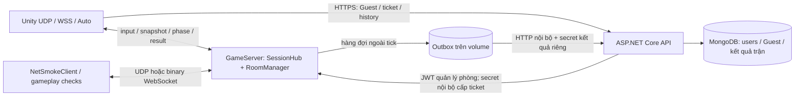

# Kiến trúc mạng Jungle Maze / Lastaway

Cập nhật Phase 2 ngày **28/10/2026**. Tài liệu mô tả kiến trúc dùng để triển khai game và ranh giới giữa các module. Setup nền nằm trong [hướng dẫn Phase 1](Phase1_First4Tasks.vi.md); chạy trận/Guest/bo theo [hướng dẫn Phase 2](Phase2_Match_Guest_Zone.vi.md). Bằng chứng nghiệm thu nằm trong [báo cáo Phase 2](Reports/Phase2_Local/report.vi.md); số liệu mạng các lượt trước ở [báo cáo Phase 1](Reports/Local_Capacity_Retest_2026-10-14/report.vi.md).

## 0. Đường chơi và phạm vi thẩm quyền

Local offline dùng OfflineMatchSession trong Unity, dữ liệu runtime có kiểm manifest và scene Game; không mở socket hoặc HTTP, không Docker, không gửi kết quả lên API/outbox. Luật solo bỏ chờ6 người và không trao LastAlive ngay; nhân vật sống tới khi bo loại rồi xem kết quả/chơi lại. Đây là chế độ luyện tập, không nguồn thành tích authoritative.

LAN dùng UDP tới IP LAN host; Online tự host dùng IP Radmin VPN với UDP, hoặc AWS Auto UDP/WSS443. Các mode này dùng cùng GameServer authoritative bên dưới; không đưa logic offline vào server online. UI chỉ hiện trường cần thiết, phần Nâng cao giữ backend loopback/CLI/profile cũ. Radmin phải được cài và cấu hình riêng; game không vượt mọi chính sách chặn mạng.

Replay có packet riêng version1, giữ nguyên layout packet cũ. SessionHub xác định người yêu cầu từ session trong room, chỉ cho nạn nhân đã bị loại lấy150frame kết thúc ở death tick server, chỉ nạn nhân+killer, tối đa3 request/người/trận. Mỗi chunk tối đa75frame (<4KiB); client kiểm shape, số frame, metadata và discard/cancel. API/DB không tham gia tick hay đọc replay. Zone/unknown killer dùng NoData, cửa sổ ngắn dùng TooShort. Tick/room/MatchId mới dọn buffer; Bootstrap nối NetworkKillcamReplaySource. Chưa có giao diện killcam combat đầy đủ từ gameplay vũ khí chưa Done.

## 1. Định hướng và trạng thái triển khai

Game dùng **server authoritative**: client gửi input; GameServer quyết định vị trí, va chạm, HP, bo, vòng đời và kết quả trận. Mỗi phòng có runtime riêng. Hạn mức cấu hình: **10 người/phòng, 5 phòng gồm mặc định, tổng 50 slot active/pending/grace**, mỗi account tạo tối đa 2 phòng bổ sung. Đây là hạn mức, không phải cam kết hiệu năng gameplay cho 50 người.

Phase 2 gồm SRV-03, NET-02, ZON-01 và demo Unity UDP/WebSocket/Auto. Prediction/reconciliation/interpolation đầy đủ thuộc MOV-02/03. Vũ khí, inventory và hazard vẫn thuộc task riêng. HUD đã nối HP/còn sống/countdown; UI-03 dùng adapter replay server riêng theo quyền phiên. Demo chỉ dùng HP cơ bản và bo; số hạ gục bằng 0.

Bản Phase 2 Local và lần mở rộng online được ghi riêng trong báo cáo Phase 2. Chỉ triển khai EC2 trong cửa sổ kiểm thử đã được chủ máy cho phép, có watchdog và Stop ở cuối. Các kết quả AWS cũ chỉ chứng minh phiên bản ghi tại lượt đo đó. Hai PC vật lý phải được kiểm tra riêng.

## 2. Topology và đường đi dữ liệu

Local: Docker publish loopback mặc định. UDP host 7777, API 5000, Mongo Compass 27018; WebSocket Local `ws://127.0.0.1:7781/game`. Trong container GameServer bind `0.0.0.0`; `PUBLISH_HOST` chọn interface của máy host. LAN chọn IP host phù hợp và mở firewall đúng cổng. HTTP chỉ dùng cho API loopback; credential dài hạn từ xa phải đi HTTPS.

AWS: EC2 hiện có, Caddy public 80/443, UDP 7777. Caddy chuyển **đúng `/game`** tới `game-server:7781`; API tới `api:5000`. Basic auth chỉ bảo vệ Swagger. Mongo 27017, room-control 7780, listener 7781 và API 5000 không publish public. Caddy phải chặn `/internal` và `/internal/*` trước tuyến API.

UDP là đường chính, WSS443 là dự phòng của cả Unity Windows/Editor và NetSmokeClient. Auto thử UDP tối đa5s, rồi WebSocket tối đa10s mở kết nối và5s join. RoomFull/ServerFull/mã sai trả thẳng; không đổi đường để vượt kiểm tra. Sau join không tự đổi đường. Mỗi lượt kết nối có attempt riêng; chuyển trong lúc join/resume giữ một slot và proof resume chỉ xoay một lần. WSS vẫn cần DNS và HTTPS được mạng cho phép. SSM chỉ dùng quản trị.

Selfhost dùng `compose.host.yaml`, DB/volume/secret riêng. VPN: Tailscale Serve HTTPS tới Caddy loopback8080; UDP qua IP VPN. Public: hostname khác AWS, Caddy80/443 và UDP7777, cần IP public/router phù hợp. Không mở Mongo, API5000, control7780 hoặc listener7781 ra ngoài. Các profile `phase2-local/lan/vpn/selfhost/aws` dùng chung schema, không bỏ kiểm tra TLS.

## 3. Project, công nghệ và trách nhiệm

| Module | Trách nhiệm |
| --- | --- |
| `Backend/GameServer/Simulation` | C# thuần 30Hz; `IMatchRuntime`, `IEntityRegistry`, `IServerClock`, `IHealthService`; map, movement, bo, kết quả |
| `Backend/GameServer/Networking` | Adapter LiteNetLib / ASP.NET WebSocket; handshake, session, resume, packet; không tự tính luật trận |
| `Backend/GameServer/Rooms` | Nguồn dữ liệu phòng; lệnh HTTP nội bộ được xếp hàng để vòng ứng dụng xử lý |
| `Backend/Shared/Protocol` | Package Unity dùng chung; schema và serializer nhị phân, không sở hữu transport |
| `Backend/Shared/GameData` | Nguồn chuẩn có version của map, luật trận và lịch bo |
| `Backend/Api` | Account/JWT, quyền chủ phòng, Guest/ticket, lịch sử và lưu kết quả authoritative |
| `Assets/_JungleMaze` | Composition root + port/service; MatchSession nhận trạng thái; view vẽ và gửi input |
| `Assets/Imported/JSurviv` | Mã tham khảo; Socket.IO cũ, `AutoConnectLegacy=false`; không tự trở thành client của backend mới |

Dữ liệu chuẩn được đồng bộ sang `StreamingAssets/JungleMaze/runtime`. Menu Unity **Jungle Maze → Phase 2 → Sync Runtime Data** tạo bản sao và manifest SHA256. Build từ chối dữ liệu cũ; client so version/hash với server trước LoadingAck. Không sửa bản sao để đổi luật server.

Map demo 50×50 có 4 cover hình chữ nhật theo scene Game; server mô phỏng nhân vật tròn, sweep/slide với cover và biên bằng C#; không chạy Unity Physics2D. 10 spawn trong bo đầu, tránh cover và cách nhau ít nhất 6 cell. Bo r25 tâm (25,25) làm các góc map nằm ngoài vùng an toàn.

## 4. Account, Guest và quyền truy cập

| Việc | Bằng chứng quyền |
| --- | --- |
| Tạo/list/xóa phòng | JWT account hợp lệ; owner từ claim `sub`, không từ user ID client gửi |
| Join/chơi | RoomCode; GameServer cấp PlayerSessionId, không tự coi đó là account |
| Hồ sơ Guest lâu dài | Credential ngẫu nhiên; Mongo chỉ giữ hash, Windows dùng DPAPI current-user theo origin API |
| Liên kết phiên với hồ sơ | Ticket ngắn hạn, dùng một lần, ràng buộc attempt + phòng; gửi credential/JWT tới API qua HTTPS, chỉ gửi ticket qua gameplay |
| Xem lịch sử cá nhân | JWT hoặc Guest credential đã xác minh, không truy vấn theo nickname |
| Ghi kết quả | GameServer qua tuyến nội bộ, secret kết quả riêng; client không được tự nộp rank/điểm |

Guest **không có quyền quản lý phòng**. Hai người cùng tên không được trộn lịch sử. Không tự gộp Guest/account theo tên. Kết quả có thể chứa người ẩn danh không gắn hồ sơ; LAN không có API vẫn chơi và xem bảng hạng trực tiếp, lịch sử online báo không khả dụng.

API: `POST /api/guests`, `POST /api/game-tickets`, `GET /api/me/matches`, `GET /api/matches/{matchId}/leaderboard`; `POST /internal/match-results` chỉ dành cho GameServer. Lịch sử phân trang, leaderboard công khai đã loại ProfileKey/credential. Các endpoint account và room cũ giữ nguyên.

## 5. Session, slot và vòng đời trận

`Waiting → Lobby → Loading → InGame → Ending → Cleanup → Waiting`.

Main: min6/max10; lobby15s không có nút Ready. Hello là xác nhận khả năng gameplay; client chỉ ping không được tính vào người đủ điều kiện bắt đầu. Thiếu người hủy countdown. Loading chốt roster, tối đa30s, loại người không xác nhận; dưới min quay về Waiting. Profile `test` dùng min2 và tăng tốc bo/timer, chỉ cho nghiệm thu Local, không dùng public hosting.

Loading/InGame/Ending từ chối người mới `MatchInProgress`. Mất mạng trong trận giữ avatar/slot15s từ lúc server phát hiện; avatar đứng yên, vẫn bị damage. Resume dùng proof ngẫu nhiên riêng, luân chuyển sau mỗi lần dùng, giữ PlayerId/slot và chỉ một kết nối điều khiển. Hết grace hoặc chủ động thoát bị loại; callback cũ không giải phóng slot mới.

Server xử lý toàn bộ damage của tick rồi xét thắng. Còn một người: thắng; không ai: hòa, không trao win. Cùng tick bị loại đồng hạng. Không có công thức điểm tổng. Mục tiêu420s không cưỡng bức kết thúc. Ending10s hoặc mọi người còn kết nối xác nhận chơi lại; dọn entity/input/bo cũ, giữ phòng và kết nối hợp lệ, tạo MatchId mới.

Protocol control v1/v2 giữ tương thích; v3 bổ sung resume. Gameplay có version riêng, MatchId, input sequence/tick và snapshot ack. Phase/roster/spawn/despawn/elimination/result gửi reliable; snapshot+zone30Hz có thể bỏ gói cũ. Client bỏ dữ liệu thuộc trận cũ. Binary WebSocket tối đa4KiB sau ghép fragment, hàng gửi có giới hạn; client chậm bị ngắt. Không gửi JWT hoặc credential Guest dài hạn qua UDP public.

## 6. Tick, Safe Zone và kết quả

Chỉ vòng ứng dụng thay đổi room/session/world. Input chuẩn hóa đường chéo, speed4 cell/s, ngừng khi thiếu input250ms; từ chối input trùng/cũ/sai trận và giới hạn tốc độ. Snapshot/ack30Hz chứa vị trí, aim, HP và sequence đã xử lý. Replay buffer riêng ít nhất5s chuẩn bị UI-03, chưa công khai killcam.

| Co bo từ lúc InGame | Bán kính |
| --- | --- |
| 90–97s | 25 → 18 |
| 182–188s | 18 → 12 |
| 268–273s | 12 → 7 |
| 343–347s | 7 → 3 |
| 387–390s | 3 → 0 |

Cảnh báo trước10s. Seed trận quyết định tâm; bo sau nằm trong bo trước và có vùng đi được/đường tiếp cận. Server phát tâm hiện tại/kế tiếp và tick co; client không tự random. Ngoài bo:5HP/s qua HealthService dùng chung, không tính giáp; cùng tick không trừ hai lần. R0 gây damage ở mọi vị trí tới khi còn tối đa một người.

Kết quả bất biến chứa MatchId, RoomId/config version, UTC, lý do, phiên/tên/hạng/kills/thời gian sống. Hàng đợi ngoài tick ghi outbox trên volume rồi gửi API nền, retry có backoff. Mongo insert nguyên tử theo MatchId: bản gửi lại giống nhau không cộng thêm; cùng khóa khác nội dung bị từ chối. API/DB lỗi không chặn mô phỏng hay màn hình kết quả; outbox đầy/lỗi phải được báo, không coi là đã lưu.

## 7. Release, dữ liệu và vận hành

Local/AWS có DB, secret, endpoint và volume riêng. `ROOM_CONTROL_TOKEN` bảo vệ room/ticket nội bộ; `MATCH_RESULT_TOKEN` bảo vệ ghi kết quả, không dùng lại JWT key. `MATCH_OUTBOX_PATH` phải nằm trên volume để retry qua restart. Tắt tính năng lịch sử khi chưa cấu hình không làm mất chức năng chơi RoomCode.

Restart giữ users/Guest/kết quả và outbox trên volume; session, trận đang chạy và phòng bổ sung trong RAM mất, phòng mặc định tạo lại. Không tự tạo kết quả cho trận bị ngắt. Update release có checksum, giữ bản trước để rollback và không ghi đè cấu hình bí mật. Triển khai AWS Phase 2 cần một cửa sổ riêng sau nghiệm thu Local.

## 8. Credits và nguyên tắc test lớp học

Dev dùng Local trước; không bật EC2 chỉ để compile/unit test. Khi cần online, đặt thời lượng và watchdog trước Start; không nâng instance/Unlimited hoặc mở port DB/control. Stop EC2 sau buổi và xác nhận Stopped; đóng client/SSH hoặc `docker stop` không dừng chi phí EC2. EBS vẫn có thể tính credits khi instance đã Stop.

Không suy diễn bài ping/pong cũ thành sức chứa gameplay. Khi bổ sung movement/combat/snapshot phải đo lại CPU, RAM, tick/dropped ticks, RTT, loss và tốc độ phát thực; lượt PC Sleep/biên dịch nặng hoặc generator thiếu tốc độ cần đánh INVALID.

## 9. Bằng chứng và phát triển tiếp

[Báo cáo chung](Reports/Local_Capacity_Retest_2026-10-14/report.vi.md) phân biệt kết quả backend Local, Unity thực, AWS UDP/WSS và lượt co-located cũ. Kiểm thử hai process Unity trên cùng PC không thay nghiệm thu hai máy vật lý.

Các dev tích hợp gameplay qua contract runtime/health/registry; combat phát damage, không tự ghi HP từ client. MOV-02/03 cải thiện cảm giác di chuyển; WPN-02 thêm combat authoritative; UI-02/03 mở rộng HUD/killcam. Các phần này chưa được coi hoàn thành bởi demo Phase 2. Khung `Application/Testing`, `OnlineScenarioRunner` và launcher `test-unity-online.ps1` nhận scenario JSON và check/driver đăng ký qua Bootstrap, dùng lại cho feature mới. Test không đủ tốc độ phát phải ghi INVALID; [checklist hai PC](../Backend/Tests/OnlineReadiness/PHYSICAL_TWO_PC_CHECKLIST.md) ghi rõ LAN/VPN/public/AWS và phần cần nghiệm thu bằng thiết bị thật.
