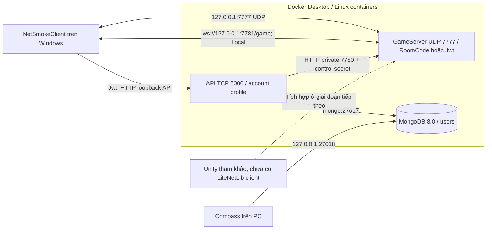
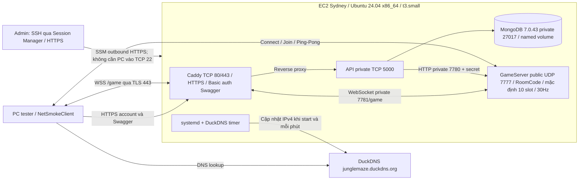
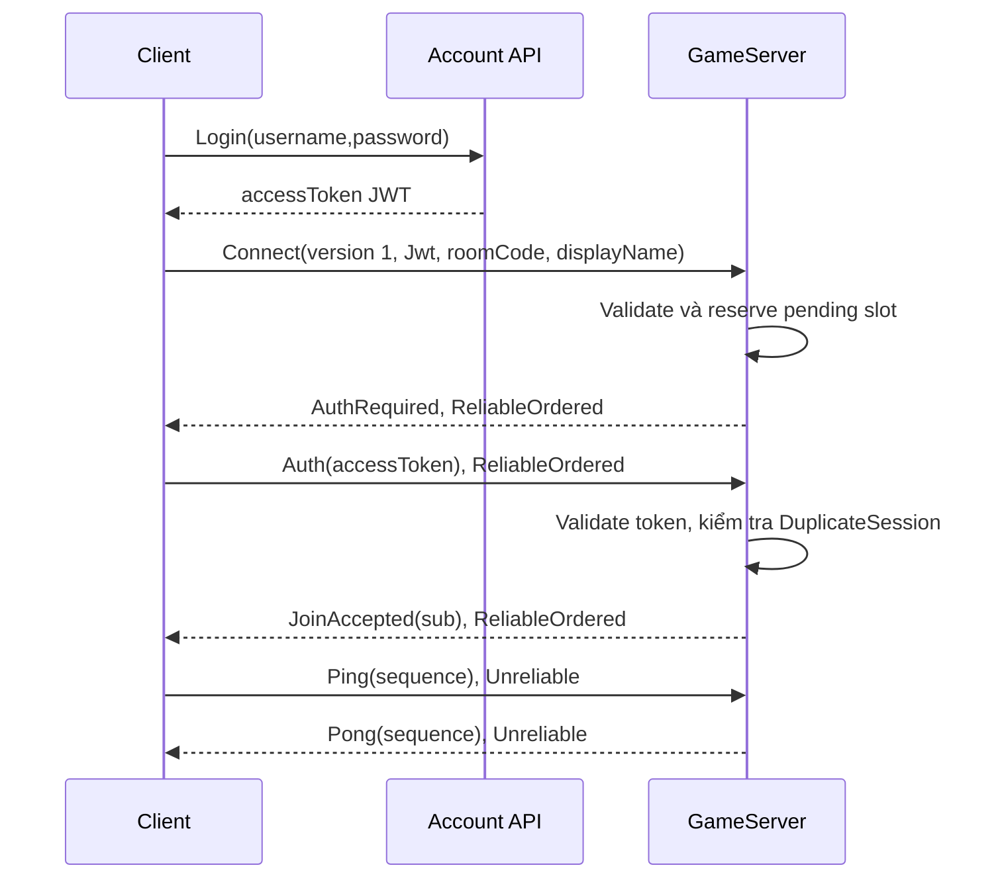
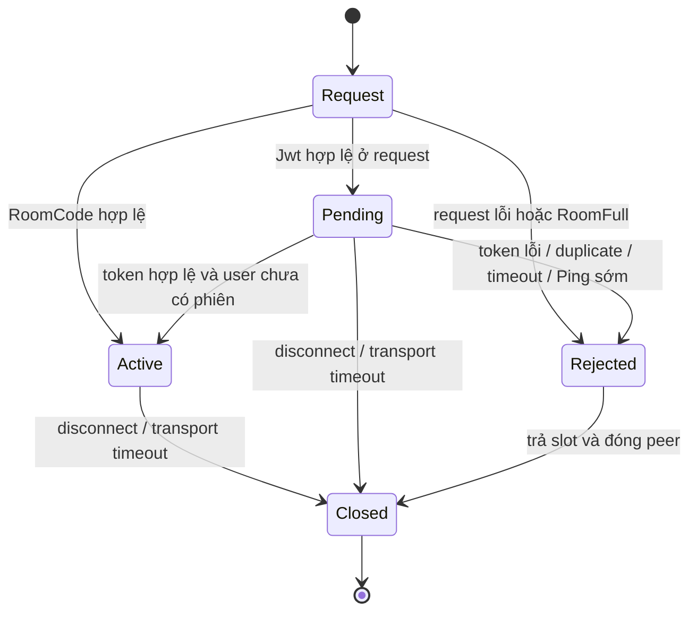

# Kiến trúc mạng Jungle Maze

Cập nhật **16/10/2026**, đối chiếu source Backend và cấu hình Unity hiện tại. Các bước setup/start/stop/test nằm trong [hướng dẫn vận hành chung](Phase1_First4Tasks.vi.md); file này giải thích hệ thống và giới hạn của nó. Phần nhiều phòng đã triển khai trên EC2; phạm vi kiểm chứng được tách rõ trong báo cáo chung.

## 1. Định hướng và trạng thái triển khai

Mục tiêu: dự án lớp học, **tối đa 10 phiên/phòng**, 5 phòng gồm mặc định, tổng server tối đa 50 phiên active/pending. Phòng bổ sung có mã join 6 ký tự chữ hoa/số; mỗi user tối đa 2 phòng tạo thêm. Đây là hạn mức, chưa phải cam kết game chạy mượt. Local dùng cho dev/debug; AWS dùng chung để test online theo lịch. Source/Compose, local và EC2 đã áp dụng 5/50. LAN/VPN là nhánh tùy chọn. Hệ thống dùng mô hình client–server với GameServer .NET độc lập, chuẩn bị cho server authoritative.

| Thành phần | Đã thực hiện | Phạm vi chưa thực hiện |
| --- | --- | --- |
| Account API | Register/login, hash có salt, unique username, JWT, /api/me, /health, Swagger | Refresh token, thu hồi token, quản lý account đầy đủ |
| GameServer | UDP LiteNetLib + binary WebSocket, SessionHub/handshake, PlayerId, RoomManager, cleanup, fixed tick 30Hz, metrics | Entity/world simulation, spawn/movement/combat/snapshot |
| NetSmokeClient | JSON/env, Udp/Wss/Auto, room/account, join/ping/pong/RTT/capacity | Render hoặc chơi game |
| AWS vận hành | Bốn services, HTTPS Caddy, DuckDNS, systemd, release/backup/guard, control phòng private, đo ping/pong 5×10 ngay trong EC2 | Nghiệm thu đường UDP PC→EC2, autoscale, mã hóa UDP public, matchmaking |
| Unity | Unity 6000.3.15f1/URP, JSurviv imported để tái sử dụng | Unity client LiteNetLib và multiplayer gameplay với backend này |

Hiện server quyết định quyền vào phòng, PlayerId và sức chứa. `Tick` chưa có gameplay nên authoritative movement/combat chưa hoạt động. JSurviv `NetworkManager` vẫn dùng Socket.IO cũ, `AutoConnectLegacy=false`; không giao tiếp được với wire protocol LiteNetLib hiện tại.

| Thuật ngữ | Hiểu trong dự án này |
| --- | --- |
| Client / server | Client là chương trình trên PC người test; server là process nhận và xử lý kết nối |
| Authoritative | Định hướng server quyết định trạng thái gameplay hợp lệ; client gửi input và hiển thị kết quả, phần này còn cần code |
| Tick / FPS | Tick là nhịp xử lý server; FPS là nhịp dựng hình của Unity, hai số khác nhau |
| Session / slot | Một phiên kết nối và chỗ được giữ cho phiên đó; pending cũng chiếm slot |
| ReliableOrdered / Unreliable | Loại gửi có bảo đảm thứ tự hoặc có thể mất/gửi đến muộn; chọn theo loại packet |
| Snapshot / prediction | Bản trạng thái world server gửi về / dự đoán tại client để bớt cảm giác trễ; chưa triển khai |

## 2. Topology và đường đi dữ liệu

### 2.1. Local trên PC dev



`compose.yaml` không có name cố định; project thường là `backend`. Profile `account` mới bật Mongo/API, RoomCode chỉ cần game-server. Mongo có healthcheck và API phụ thuộc Mongo healthy. API Local không có Docker healthcheck; phải gọi /health để xác nhận DB.

Windows publish port lấy từ `.env`; server trong container luôn dùng GAME_PORT 7777. PUBLISH_HOST chọn interface Windows, GAME_BIND_ADDRESS chọn interface trong container. API Windows debug dùng profile http/cổng 5204 và connection string loopback 27018, khác API Docker với `mongo:27017`.

### 2.2. AWS public Online



`compose.aws.yaml` là standalone, project cố định **junglemaze-aws**. Bốn service luôn bật, có restart `unless-stopped`. Không merge với Local Compose để tránh publish nhầm port. /health đi Caddy → API → Mongo, không kiểm tra UDP game.

| Service | Nội bộ | Publish / người dùng | RAM / lưu trữ |
| --- | --- | --- | --- |
| GameServer | UDP 0.0.0.0:7777 | UDP 7777 public, tester dùng RoomCode | 256MiB, session trong RAM |
| API | TCP 5000 | Chỉ Caddy trong Docker network | 384MiB; users ở Mongo |
| Mongo | TCP 27017 | API private; admin qua SSH tunnel | 768MiB, cache 0.25GiB, mongo-data |
| Caddy | TCP 80/443 | HTTPS public, HTTP redirect | 128MiB, caddy-data/caddy-config |

Security group: TCP 22 chỉ IP admin; TCP 80/443 và UDP 7777 public IPv4. API/Mongo không có host port. Caddy dùng h1/h2, không publish UDP 443. Root EBS gp3 20GB mã hóa giữ Docker data/config; swap 1GiB dự phòng. Tổng giới hạn RAM container là 1.5GiB; phải đo thực tế trên EC2, không coi giới hạn này là bằng chứng game 10 người mượt.

API account AWS dùng HTTPS. Proxy Basic auth chỉ bảo vệ `/swagger` và `/swagger/*`. /api/me vẫn cần Bearer JWT; register/login cho phép anonymous theo API contract. Mongo chưa bật auth trong cấu hình hiện tại: được bảo vệ bằng private network và quyền SSH/admin, không expose DB.

### 2.3. UDP chính, WSS dự phòng dùng chung phòng

Backend cung cấp UDP LiteNetLib 7777 và WebSocket binary nội bộ 7781 tại `/game`; Caddy chuyển tiếp `wss://junglemaze.duckdns.org/game` qua HTTPS 443. Listener WebSocket 7781 và control 7780 không publish trên AWS. API/Swagger/Mongo giữ cấu hình cũ; Basic auth chỉ bảo vệ Swagger, không áp vào đường game.

`SessionHub` sở hữu identity, RoomManager và slot; UDP và WebSocket là hai adapter cùng gọi vào nó. Các thao tác phòng/session chạy tuần tự trên application loop; Kestrel chỉ enqueue byte qua queue 1024 sự kiện, drain tối đa 256/vòng. Mỗi socket có queue gửi 64 message, send timeout 2s; socket chậm bị đóng/trả slot. Không await socket/API/DB trong tick. Socket chưa gửi handshake bị giới hạn riêng tối đa 2×MAX_TOTAL_PLAYERS và timeout 5s; chưa có phòng/PlayerId nên chưa phải slot player. Sau handshake hợp lệ, cả pending auth và active của hai transport cùng chịu 10/phòng, 50/server.

Protocol UDP v1 vẫn được nhận. V2 thêm 16 byte mã lượt kết nối ngẫu nhiên sau payload connect cũ, tối đa 272 byte; WSS yêu cầu v2 và dùng chính application messages Join/Auth/Ping/Pong, không bọc packet LiteNetLib. WebSocket ghép fragment tối đa 4096 byte và chỉ nhận binary. Mã lượt kết nối không được log, không phải account ID hoặc PlayerId.

Auto thử UDP trong 5s; lỗi transport trước JoinAccepted mới chuyển WSS (tối đa 10s mở và 5s join). Mã sai/phòng đầy/phiên bản sai không kích hoạt fallback. V2 cho phép chuyển một lần từ UDP chưa có thông điệp ứng dụng hợp lệ sang WSS, giữ PlayerId và tối đa một slot. Route UDP cũ bị tháo trước, callback đến muộn không giải phóng/tạo lại slot. Sau thông điệp ứng dụng đầu tiên, attempt bị khóa; nonce của phiên đã kết thúc được giữ 30s để chặn replay, tối đa 4096 records. Khi đã join, client giữ tuyến, mất mạng báo lỗi và reconnect bằng attempt/PlayerId mới; chưa có resume gameplay.

NET_TRANSPORT và NET_WS_URL override `transport`/`webSocketUrl` trong JSON. Config cũ thiếu transport mặc định Udp; Wss/Auto cần v2. Remote bắt buộc wss/certificate hợp lệ; ws chỉ được dùng loopback. Hai môi trường Local/AWS dùng code/secret/DB riêng. Các profile `client.local-auto.json`, `client.lan-v2.json`, `client.aws-auto.json` chuẩn bị cho tích hợp Unity sau này; client Unity chưa được triển khai.

`webSocketConnectIp` / NET_WS_CONNECT_IP là pin TCP tùy chọn, rõ ràng trong config/report: SocketsHttpHandler nối tới IP chỉ định, giữ URI/SNI và xác minh certificate chain/hostname mặc định. Không sửa hosts/DNS toàn máy; ws chỉ được pin loopback. Bài AWS dùng pin để tránh dòng hosts cũ trên PC; đó là kiểm transport public, không tự chứng minh resolver PC đã đúng. Profile LAN Auto cần TLS hợp lệ tới cùng server LAN, không fallback sang AWS khác server.

Tạo/list/xóa phòng vẫn HTTPS + JWT; account ID ở sub, còn join RoomCode nhận PlayerId ngẫu nhiên do server cấp. API account không nằm trên đường ping/tick. SSM chỉ quản trị, Tailscale là công cụ tùy chọn cũ, không yêu cầu cài cho người chơi. WSS cần mạng cho phép HTTPS/Upgrade và DNS đúng; không đảm bảo truy cập được khi cả hostname/443 bị chặn. Xem mục 16 trong hướng dẫn chung và báo cáo mới nhất để biết tuyến nào đã thực sự kiểm chứng.

## 3. Project, công nghệ và trách nhiệm

```text
Backend/
  JungleBackend.sln, global.json, Directory.Build.props
  compose.yaml, compose.aws.yaml, .env.example
  Api/
    Program.cs, Dockerfile
    Models/User.cs, DTOs/AuthDtos.cs, Data/MongoDbContext.cs
    Repositories/IUserRepository.cs, UserRepository.cs
    Services/AuthService.cs, TokenService.cs, JwtOptions.cs
    Controllers/AuthController.cs, MeController.cs
    Swagger/BearerSecurityOperationFilter.cs
  GameServer/
    Program.cs, Dockerfile
    Configuration/ServerOptions.cs, JwtSettings.cs
    Networking/NetworkHost.cs, SessionHub.cs, IGamePeer.cs, WebSocketHost.cs, HandshakeValidator.cs
    Simulation/FixedTickLoop.cs, Diagnostics/ServerMetrics.cs
  Shared/Protocol/  (package com.junglemaze.protocol: NetworkProtocol.cs, asmdef, package.json)
  NetSmokeClient/
    Program.cs
    client.local.json, client.lan.json, client.online.json, client.aws.json
    Configuration/ClientOptions.cs
    Services/CredentialInput.cs, AccountLogin.cs
    Networking/SmokeSession.cs, WebSocketClientTransport.cs
  Deploy/
    build-aws-release.ps1
    Aws/Caddyfile
    Aws/scripts/{bootstrap,configure,deploy,start,stop,status}.sh
    Aws/scripts/{backup,restore,rollback,check-mongo-volume}.sh
    Aws/scripts/duckdns.py, common.sh
  Tests/
    run_all.cmd, auth_smoke.py, NetworkChecks/
    aws_smoke.py, aws_mongo_guard.py, verify_aws_release.py
```

| Module / pattern đang có | Trách nhiệm và dữ liệu |
| --- | --- |
| API Controller → Service → Repository, DI | HTTP validation/status; hash/verify; query/unique index Mongo |
| TokenService/JwtOptions | HS256 JWT, sub/issuer/audience/nbf/exp/iat/jti; secret chỉ server |
| GameServer/Program, composition root | Đọc options, tạo metrics/network/loop, xử lý dừng và dispose |
| ServerOptions/JwtSettings/RoomOptions | Validate IPv4/port/auth, phòng mặc định 1–10, tổng phiên/phòng, control key, 30Hz/deadline; guard public RoomCode |
| HandshakeValidator | Validate request và token; không gọi DB/API |
| NetworkHost / WebSocketHost | Adapter UDP / binary WebSocket; socket async đưa sự kiện vào hàng đợi |
| SessionHub / IGamePeer | Session, handshake, PlayerId, slot chung; chuyển lượt UDP → WSS, chống callback cũ |
| RoomManager | Nguồn dữ liệu phòng trong RAM: code → phòng, owner/quota/TTL/slot từng phòng |
| RoomCommands/RoomControlHost | HTTP secret riêng, queue tối đa 128 yêu cầu, drain tối đa 16/vòng trên thread UDP |
| API RoomsController/RoomControlClient | JWT sub → owner; chuyển CRUD phòng qua HTTP private, 5 create/phút/user |
| FixedTickLoop | Accumulator, fixed delta 1/30, giới hạn catch-up |
| ServerMetrics | CPU/tick/loop/slot/reject/invalid/drop theo cửa sổ |
| Shared/Protocol | Hợp đồng byte; Compile Link vào server/client và là Unity local package (`file:../Backend/Shared/Protocol`), giữ cú pháp C# 9 |
| ClientOptions/CredentialInput/AccountLogin | Endpoint JSON, nhập secret, HTTP login tùy mode |
| SmokeSession / WebSocketClientTransport | Một lượt kết nối Udp/Wss/Auto; fallback trước join, ping/RTT, hàng đợi socket có giới hạn; không tự reconnect sau join |

Backend target **net8.0**, SDK chọn **8.0.403/latestPatch**. GameServer/NetSmokeClient dùng LiteNetLib **2.1.4**. API dùng MongoDB.Driver **3.12.0**, JwtBearer **8.0.31**, Swashbuckle **10.3.0**; GameServer JWT **7.7.3** khớp dependency token của API. `Directory.Build.props` tắt `EnableProjectDataOnBuild` khi build thường để tránh task cache .NET 10 của C# Dev Kit 11.3.30 bị nạp vào SDK 8.

Pooling/command/state trong assets JSurviv là nguồn tham khảo gameplay; chưa đồng nghĩa các pattern đó đã được chuyển vào backend mới. Dùng [bản đồ module JSurviv](JSurviv_Integration.vi.md) để chọn phần tái sử dụng.

## 4. Account, identity và hai luồng join

### 4.1. RoomCode, dùng trên AWS

Sơ đồ dưới mô tả UDP v1 tương thích cũ. UDP v2 thêm attempt ID; WSS v2 dùng cùng nội dung handshake/application message qua binary WebSocket. Ping/Pong qua WSS có thứ tự và độ tin cậy của TCP, không dùng gói Unreliable của LiteNetLib.

```mermaid
sequenceDiagram
    participant C as Client
    participant G as GameServer
    C->>G: Connect(version 1, RoomCode, roomCode, displayName)
    G->>G: Tra phòng theo code; reserve nếu phòng và tổng server còn slot
    G->>G: Cấp Guid PlayerId
    G-->>C: JoinAccepted(playerId), ReliableOrdered
    C->>G: Ping(sequence), Unreliable
    G-->>C: Pong(sequence), Unreliable
```

Không gọi API/Mongo để join. Room code dùng chung buổi test, không chứng minh account identity. Client không tự chọn PlayerId; reconnect nhận Guid mới. PeerId của transport khác PlayerId; displayName không phải identity. Chưa giữ HP/inventory qua disconnect.

### 4.2. Jwt, Local/VPN được cấu hình



API và GameServer dùng cùng issuer/audience/signing key. Cả hai kiểm chữ ký HS256, issuer/audience/lifetime, signed token, expiry và clock skew 30 giây. Server còn yêu cầu sub duy nhất, không rỗng, tối đa 64 ký tự. UserId lấy từ token đã validate, không tin claim client tự đọc.

API Trim username rồi chuẩn hóa UpperInvariant, tạo unique index `ux_users_normalized_username`; password giữ khoảng trắng và được hash có salt. UserId là Guid string trong Mongo `_id`. Register không tự login/join. Token giữ trong client memory/env, không trong endpoint JSON.

Validate JWT lúc join; không query Mongo để kiểm account đã xóa/khóa và không có revocation. Token hết hạn sau khi phiên đã active không tự đá phiên; join mới cần token hợp lệ. Chống duplicate áp dụng trong process GameServer hiện tại, chưa phải hệ thống nhiều server.

### 4.3. Bảo vệ đường truyền

`PUBLIC_HOSTING=true` bắt buộc RoomCode. JWT được ký nhưng UDP chưa mã hóa. HTTPS của Caddy bảo vệ API, không bảo vệ UDP game. AWS chỉ dùng room riêng cho buổi lớp, không dùng password làm room. Public JWT game cần cơ chế encryption và đánh giá lại trước khi bật; guard hiện chặn việc đổi nhầm mode.

Client Jwt từ xa chỉ chấp nhận HTTPS hợp lệ hoặc Online/IP Tailscale 100.64.0.0/10; code không tự tạo VPN. Local HTTP loopback được phép, LAN HTTP account thường bị chặn. Mode Online là nhãn config, không tự đảm bảo đường truyền.

API public: body limit 16KiB, register/login dùng chung fixed window 60 request/phút, queue 0, trả 429 khi quá quota. Local dùng NoLimiter. Không tin X-Forwarded-For do client gửi để chia quota. Swagger admin Basic auth và account JWT là hai quyền riêng.

### 4.4. Quản lý nhiều phòng

Luồng tạo phòng: **Swagger JWT → RoomsController → HTTP private TCP 7780 → queue → RoomManager trên thread UDP**. Account `sub` là chủ phòng; không tin user ID gửi trong body. API cung cấp POST/GET/DELETE `/api/rooms`; GET trả phòng mặc định (ẩn code) và phòng của chính user, code bổ sung chỉ trả cho chủ. DELETE yêu cầu phòng của mình, trống cả active/pending; phòng mặc định được bảo vệ.

RoomManager là nguồn dữ liệu phòng duy nhất trong process, sinh mã 6 ký tự bằng bộ sinh mật mã và kiểm không trùng, gồm cả mã mặc định. Dùng bảng chữ hoa/số `ABCDEFGHJKLMNPQRSTUVWXYZ23456789`, nhập đúng chữ hoa; loại I/O/0/1 để giảm nhầm lẫn. Mỗi phòng giữ ID/tên/chủ/sức chứa/danh sách peer riêng. Giữ mã mặc định từ `ROOM_CODE` và `MAX_PLAYERS=10`; phòng bổ sung tối đa 10, tổng phiên 50, tối đa 5 phòng gồm mặc định, 2 phòng bổ sung/user. Cần ít nhất hai user để tạo đủ bốn phòng ngoài mặc định. `RoomLimits` dùng chung để API/Swagger và GameServer thống nhất giới hạn; cấu hình vượt phương án bị từ chối khi khởi động. Không dùng Mongo để lưu phòng tạm; restart GameServer mất phòng bổ sung. Phòng bổ sung trống liên tục 600 giây sẽ thu hồi, thời gian trống bắt đầu lại khi peer cuối rời đi.

HTTP nội bộ dùng `ROOM_CONTROL_TOKEN` random ≥32 byte riêng, so sánh fixed-time; không truyền JWT player tới control. Cổng 7780 không publish ra host/Internet và không mở Security Group. HTTP handler chỉ enqueue vào bounded queue 128, tối đa 16 lệnh/vòng poll, deadline 3s; UDP app xử lý tuần tự để kiểm quota và slot không bị race. Không gọi HTTP/Mongo trong Tick. Hết hạn trước khi xử lý thì bỏ lệnh; API trả 503 khi chưa cấu hình/busy/unavailable. Thiếu secret vẫn cho chạy UDP phòng mặc định.

POST giới hạn fixed window 5 yêu cầu/phút theo JWT sub, kể cả yêu cầu validation/quota lỗi. Tên 1–48 ký tự, capacity không vượt giới hạn một phòng hoặc tổng server. Mã join/secret/JWT/password không ghi log; metrics chỉ ghi room ID và occupancy. API không cung cấp endpoint chuyển phòng: client disconnect rồi join với code mới. Các phòng dùng chung process/CPU/tick; chưa có world gameplay riêng hay cách ly hiệu năng giữa phòng, chưa phải matchmaking/multi-server.

GameServer dùng thêm ASP.NET Core shared framework; Docker runtime `aspnet:8.0`. Local API/GameServer nhận cùng secret từ `.env`. AWS Compose cấu hình đường private và migration thêm key nếu thiếu; bài đo AWS là lượt riêng, không dùng số local thay cho số EC2. Cách setup, thông số và bài đo nằm ở mục 14 của hướng dẫn chung.

## 5. Session, slot và packet



- Reserve ngay khi Accept request, trước callback PeerConnected, nên burst không vượt sức chứa từng phòng hoặc tổng server. Pending JWT chiếm slot ở cả hai mức.
- Pending deadline mặc định 5000ms; kiểm tra trong receive và sau mỗi PollEvents. Chỉ nhận Auth ở channel 0/ReliableOrdered.
- Sau JoinAccepted client mới gửi Ping. Packet active thiếu/thừa/lạ bị đếm/bỏ; server tiếp tục xử lý packet hợp lệ.
- Mapping userId được reserve/activate trong cùng callback, không await giữa kiểm tra và ghi. Cleanup idempotent, chỉ xóa mapping đúng owner.
- DisconnectTimeout transport là 5000ms. Reject/disconnect/timeout trả slot; client không tự reconnect/fallback để che lỗi.

| Message / type | Dữ liệu theo thứ tự | Delivery / giới hạn |
| --- | --- | --- |
| Connection request | ushort version 1, byte mode (0 RoomCode/1 Jwt), string room, string name | ≤256 byte; room ≤64 ký tự, name sau Trim ≤32 |
| Ping 1 / Pong 2 | byte type, int sequence >0 | Unreliable, đúng 5 byte |
| Auth 3 | byte type 3, string JWT | ReliableOrdered, token ≤2048 ký tự, packet ≤4096 byte |
| JoinAccepted 4 | byte type 4, string PlayerId | ReliableOrdered, ID ≤64 ký tự |
| JoinRejected 5 | byte type 5, string reason | ReliableOrdered; kèm reason trong reject/disconnect data |
| AuthRequired 6 | byte type 6 | ReliableOrdered, đúng 1 byte |

Dùng NetDataWriter/NetDataReader của LiteNetLib, channel 0. Kiểm đủ byte/length/trailing bytes; Unicode phải thỏa cả char và byte. Auth gửi riêng khỏi request để hỗ trợ token fragmentation. AutoRecycle=true nên không recycle reader lần hai.

Reason có MalformedRequest, PayloadTooLarge, UnsupportedVersion, AuthModeMismatch, InvalidRoomCode, InvalidDisplayName, RoomFull, ServerFull, AuthenticationRequired, InvalidToken, AuthTimeout, DuplicateSession. Nếu phòng đã đầy ưu tiên RoomFull; nếu phòng còn slot nhưng tổng server đầy trả ServerFull. Key smoke cũ `JungleMaze.SRV01.v1` không còn dùng. Giữ định dạng UDP v1 cho client hiện có; v2 bổ sung nonce cho UDP/WSS Auto như mục 2.3.

## 6. Vòng tick, số đo và giới hạn tải

[Báo cáo mới nhất](Reports/Local_Capacity_Retest_2026-10-14/report.vi.md) giữ riêng local 14/10 và AWS 16/10. Local dùng source snapshot nới policy: một phòng 50, năm phòng ×10 và sáu phòng ×10 đạt 180s; bảy phòng ×10 trượt p95 một phòng 55,71ms. AWS t3.small xác nhận 5 phòng ×10 trong 180s với generator cùng EC2, không loss/drop; UDP từ PC chưa thông nên chưa nghiệm thu RTT Internet hoặc gameplay. Policy hiện tại 10/50/5/2 đã áp dụng source/config/local/EC2. Không dùng số local 6 phòng làm hạn mức triển khai.

Application thread: **PollEvents → Tick → metrics report → sleep ngắn**. LiteNetLib có thread transport nội bộ nhưng app không bật unsynced events; callback/session mappings và Tick được xử lý tuần tự.

Stopwatch/accumulator giữ thời gian dư, mỗi Tick dùng delta 1/30 giây. Catch-up tối đa 5 bước mỗi vòng; backlog nguyên tick dư bị bỏ và đếm droppedTicks. Sleep tối đa khoảng 5ms để nhường CPU/poll; sleep không là đồng hồ tick. Không HTTP/DB/await trong Tick; điểm gắn input/world simulation chưa viết.

Metrics mặc định mỗi 5 giây: active/pending/peers, ticksPerSecond, tick và work loop p95/p99, cpuOneCorePercent, overrun/drop, ping/invalid/reject. Work loop loại sleep/log; CPU chuẩn một core, 100% là một core bận, có thể >100%. Samples có giới hạn và bộ đếm cửa sổ reset sau report.

NetSmokeClient hỗ trợ 1–256 phiên, ping mặc định 1Hz, cấu hình 1–60Hz. Benchmark dùng 30Hz, ít log, warm-up 15s rồi đo 60s (xác nhận 180s), thống kê join/reject/disconnect, ping/pong/timeout và RTT p95/p99. Mỗi client giữ tối đa 16.384 mẫu RTT gần nhất; bài đo 180s/30Hz nằm trong giới hạn. Tốc độ gửi thực tế dưới 95% yêu cầu làm lượt đo không hợp lệ. Client chưa chứng minh FPS hoặc combat; phải đo lại khi có movement/combat/snapshot.

`--room-plan` nhận file riêng tư gồm ID/mã/số client từng phòng, để một process phát tải nhiều phòng đồng thời; report chỉ ghi ID, không ghi mã. Công cụ `local_capacity_probe.py` chạy trên Docker local riêng, dùng control endpoint để provision, không dùng API account/MongoDB và không đo JWT hoặc rate limit Swagger. Trần thử nghiệm 256 phiên/32 phòng là phạm vi công cụ, không phải sức chứa đã xác nhận. Cách chạy và cleanup ở mục 14.5 của hướng dẫn chung.

## 7. Release, dữ liệu và vòng đời vận hành

| Môi trường | Source/phiên bản DB | Start/stop | Dữ liệu |
| --- | --- | --- | --- |
| Local | Build từ source, Mongo 8.0 ở account profile | Docker Desktop/Compose, không auto-restart policy | Named volume thường backend_mongo-data |
| AWS | Image Linux AMD64, Mongo 7.0.43 khóa ở builder | systemd boot + unless-stopped; admin Stop EC2 sau test | Project/volumes junglemaze-aws cố định, root EBS |

Builder Windows multi-stage .NET 8 tạo image API/game, lấy Mongo 7/Caddy 2 rồi tag theo release ID. Manifest lưu image IDs và mongoVersion. Docker save/gzip đóng bốn image, scripts, public config, docs và SHA256SUMS. Secret/DB/source Unity/bin/obj không được gom từ workspace. `verify_aws_release.py` kiểm checksums, đủ images Linux AMD64, text LF/UTF-8 và không private config.

EC2 bootstrap chỉ cài Docker/Compose/Python và swap. Deploy load images, copy release; config private tách ở `/opt/junglemaze/config/.env.aws` (0600). `current`/`previous` là symlink release; container name/project không đổi theo thư mục upload. Bản cài bỏ images.tar.gz để tiết kiệm bản sao: deploy từ bundle đã giải nén đầy đủ, không từ current.

| Script | Trách nhiệm |
| --- | --- |
| bootstrap.sh | Ubuntu 24.04/x86_64 runtime, Docker, swap, thư mục private |
| configure.sh | Lần đầu nhập DuckDNS/email/Swagger/room; sinh JWT key, bcrypt Swagger; không ghi đè config |
| deploy.sh | Checksum, load, guard volume, cài release/current, units/timer, start |
| start.sh / stop.sh | Compose up wait / stop 20 giây, giữ volume; không gọi AWS API Stop instance |
| status.sh | Compose ps, stats, endpoint và game logs |
| duckdns.py | HTTPS update IPv4 egress khi start/boot và timer 60 giây; không log token |
| backup.sh / restore.sh | mongodump gzip/jungle_maze; restore --drop có xác nhận RESTORE, dừng API/Caddy rồi bật lại |
| check-mongo-volume.sh | Chỉ đọc volume; chặn 8/unknown→7 nếu có file; không xóa/sửa data |
| rollback.sh | Đổi current/previous, restart; chặn khác Mongo major, không rollback DB/schema/config |

Mongo AWS 7 được chọn sau lỗi 8.0.32 trên kernel EC2 7.0.0-1014-aws. Đây là bản sửa cho DB test mới; DB 8 có data cần migration dump/restore trên host tương thích. Docker local/kernel WSL 5.15 không tái hiện lỗi đó; không giả định tất cả host Linux giống nhau. [Nguồn MongoDB](https://jira.mongodb.org/browse/SERVER-125742).

DB chỉ giữ users/account; sessions/room GUID trong RAM mất khi restart. Local và AWS là database/key khác nhau. Compass Local đi loopback 27018, AWS qua SSH 27019 tới IP Mongo nội bộ; không publish DB public. Backup users không gồm JWT key/DuckDNS token/cert; bản backup còn trên EBS không thay thế bản sao ngoài EC2.

Systemd Type=oneshot `active (exited)` là trạng thái thành công sau compose up. Boot bật dịch vụ và timer DNS; IPv4 public có thể đổi khi Stop/Start, DuckDNS cập nhật lại. Compose wait kiểm Mongo/API healthy, game/Caddy Running; chưa thay bài TLS/UDP ngoài Internet.

## 8. Credits và nguyên tắc test theo định hướng lớp học

AWS (new)/Free Plan hiện ở Sydney, một EC2 t3.small. Admin giữ CPU Standard và xác nhận eligible/credits trong console. Dev dùng Local, tester dùng server chung. Không bật EC2 trong lúc build release hoặc chạy test tự động trên PC.

Compute phát sinh usage khi EC2 Running, kể cả idle/app đã stop. `systemctl stop` dừng container, chưa Stop EC2. Stop từ Console giữ EBS nhưng ngừng compute; IPv4 tự cấp được giải phóng, EBS 20GB vẫn có phí giữ data. Free Plan có hạn 6 tháng hoặc đến khi credits cạn; Paid Plan có thể tính phí vượt credits. Các bước kiểm Billing, lịch test, backup và Stop xác nhận nằm ở mục 7 của hướng dẫn. [AWS lifecycle](https://docs.aws.amazon.com/AWSEC2/latest/UserGuide/ec2-instance-lifecycle.html), [AWS plans](https://docs.aws.amazon.com/awsaccountbilling/latest/aboutv2/free-tier-plans.html).

Chạy test ngắn/có duration, một client trước 10 phiên. Client duration=0 không có nghĩa server sẽ tự tắt. Người quản lý xác nhận Stopped sau buổi. Script test-aws-rooms.ps1 có Stop trong finally, watchdog PC và timer EC2 30 phút cho buổi benchmark. Buổi thông thường dùng open-aws-session.ps1 với thời lượng bắt buộc để đặt timer/watchdog; nếu bật thủ công từ Console thì admin phải tự quản lý giờ Stop. Đây không phải trần chi tiêu toàn tài khoản.

## 9. Bằng chứng và hướng phát triển tiếp

Trong phiên 12/10/2026 đã ghi nhận 69 network +48 API/e2e checks, 35 AWS Docker checks với Mongo 7 và 8 volume guard checks; bundle được verify. Build và workaround MSB4062 đã kiểm tra. Admin báo EC2 deploy qua; HTTPS /health đã trả ok/database connected. Đây là kết quả tại thời điểm kiểm tra; runtime hiện tại phải xem Console/health.

Đã có phép đo backend 5 phòng ×10 trên EC2 với xác nhận 3 phút và generator dùng chung máy qua SSM. Chưa có bằng chứng UDP online 10 máy từ lớp, lượt gameplay 5 phút hoặc FPS/full match Unity. Nghiệm thu bốn task INF-01/NET-01/SRV-01/SRV-02 theo bảng trong hướng dẫn; không suy ra gameplay Done.

Rà soát mới nhất: Local UDP/WebSocket 10 phiên/300s PASS; 132 network, 44 dual-transport và 50 account checks. PC → EC2 WSS public với TCP IP pin/TLS hợp lệ đạt 10 phiên/300s, Auto fallback và Stop–Start rejoin PASS; EC2 đã Stopped. UDP public vẫn BLOCKED trên mạng này. Public DNS từ EC2 đúng sau cả hai Start; hosts PC còn ghim IP cũ, nên hostname mặc định trên PC vẫn BLOCKED, không coi IP pin là đã sửa DNS. WAN RTT p95 khoảng 591ms: ổn định transport, chưa kết luận gameplay mượt. Hai PC thật/10 người thật vẫn NOT_TESTED. Chi tiết và lượt PC mất mạng được giữ trong báo cáo chung; hướng dẫn mới ở mục 16.

Thứ tự tiếp theo: xử lý DNS/hosts PC và nghiệm thu hai PC thật → Unity network client UDP/WSS/endpoint/join → server world và hai nhân vật đồng bộ input/movement → combat/HP/item/round → snapshot/interpolation/prediction/reconnect → đo 10 máy thực. Phải thiết kế mô phỏng/collision cho .NET server độc lập, không giả định server đã có Unity physics. Public JWT game/encryption và account revocation là phạm vi riêng, chưa bật.

### Kiểm chứng nhiều phòng trên AWS

Luồng tạo phòng luôn là HTTPS + Bearer JWT → API xác minh chữ ký/issuer/audience/expiry → lấy chủ từ sub → HTTP private có control secret → hàng đợi UDP → RoomManager. Swagger Basic auth chỉ mở giao diện, không thay thế JWT. UDP public tiếp tục dùng RoomCode; mã 6 ký tự không phải token đăng nhập.

Chính sách vận hành là 10 phiên/phòng, 5 phòng gồm phòng mặc định, tổng 50 active/pending, 2 phòng bổ sung/user. Đo AWS dùng chính chính sách này, không nới hằng giới hạn. Hai owner tạo bốn phòng, user thứ ba kiểm hạn mức tổng/rate; fixture accounts lưu Mongo, còn phòng ở RAM và được dọn cuối buổi. TTL phòng được kiểm local để tránh chờ 10 phút trên EC2.

Admin dùng Deploy/test-aws-rooms.ps1 quản vòng đời EC2, Tools/room_benchmark.py đo API/UDP và room-test.sh thu telemetry/đổi JWT tạm thời. Không có endpoint test public mới. Chỉ cập nhật image API/GameServer; control TCP 7780 và Mongo không publish. Override JWT dưới /run, có timer khôi phục; base config và key không đổi.

Bài đo có thể chạy từ PC khi UDP thông: tăng 10 → 30 → 50 phiên, xác nhận mức đạt trong 3 phút. RTT p95 xét từng phòng so với baseline Internet +50ms, tốc độ phát xét từng client; CPU/RAM/tick/drop lấy từ server/cgroup. Quy trình có Stop trong finally, watchdog PC và timer shutdown EC2 30 phút (chỉ khi shutdown=stop). Chi tiết thao tác ở mục 14.7 của hướng dẫn vận hành; kết quả thực đo ở báo cáo chung, không suy ra sức chứa gameplay.

Khi mạng PC chặn UDP, chế độ GeneratorOnServer dùng SSH qua SSM cho quản trị, tunnel TCP loopback tới Caddy 443 cho HTTPS API, và đặt NetSmokeClient trong container tạm trên EC2 (256MiB, 0.75 core). GameServer vẫn giữ 256MiB; Mongo/Caddy giữ nguyên. Đây là phép đo backend trong cùng EC2, có cạnh tranh tài nguyên với generator; RTT là nội bộ host. Không có tunnel UDP công khai, không chuyển JWT sang UDP và không coi bài này là nghiệm thu đường Internet/10 máy lớp học.
